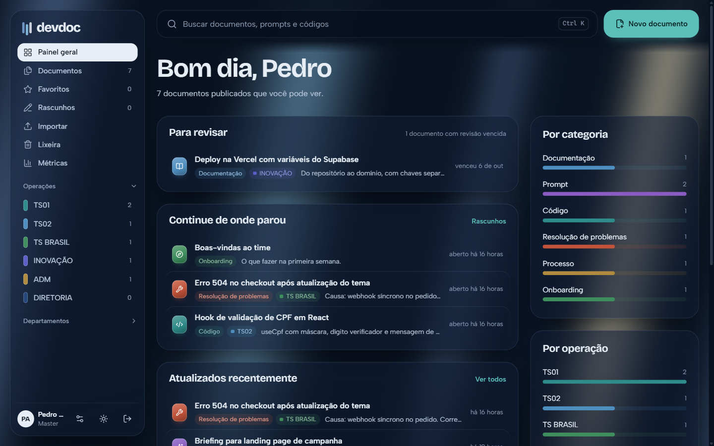
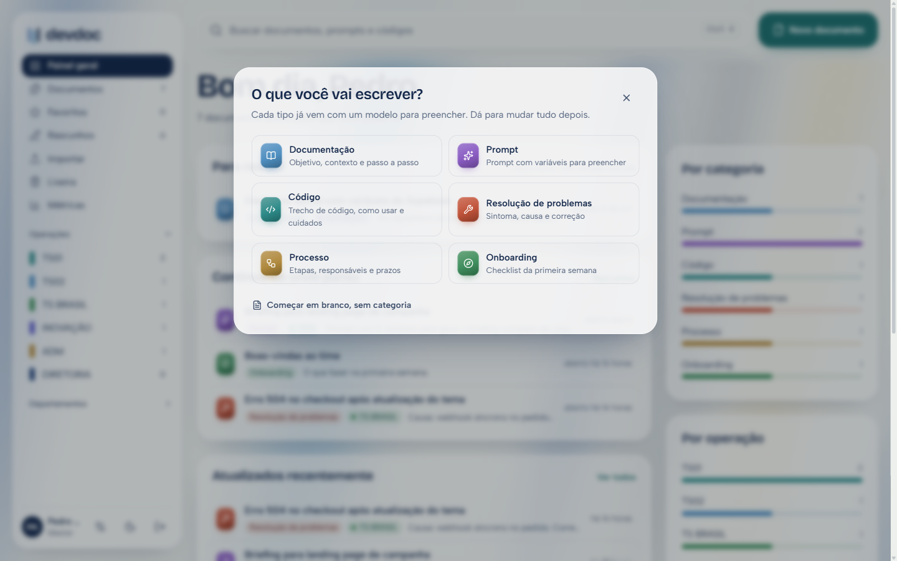
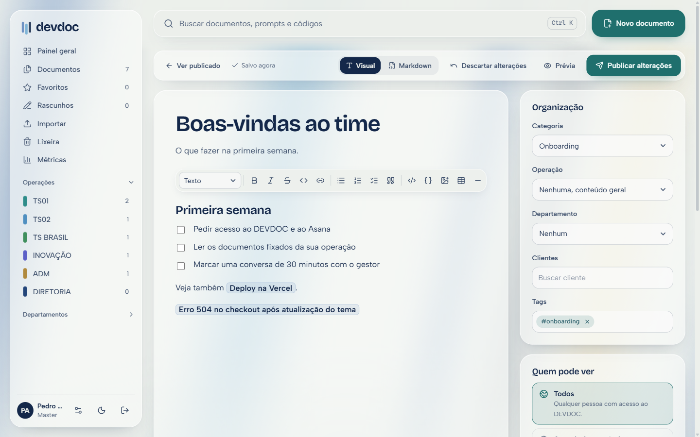
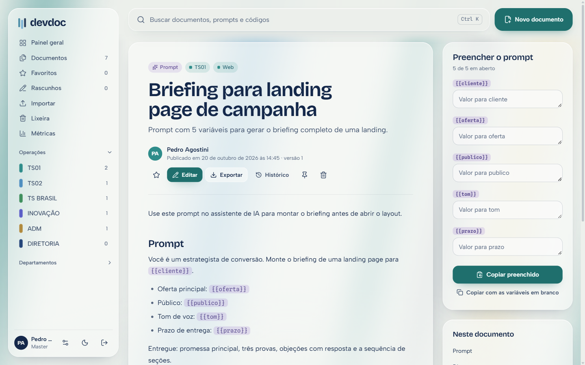
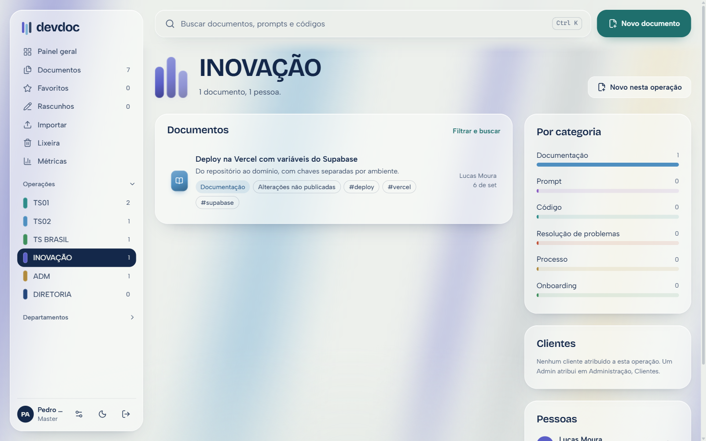
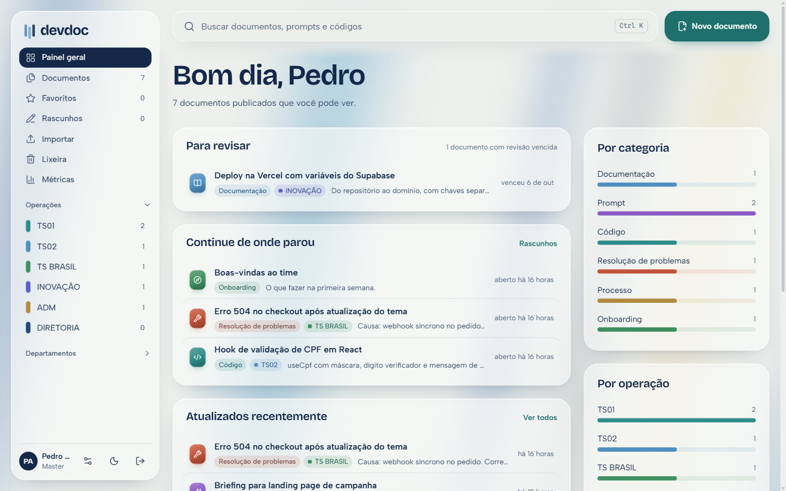
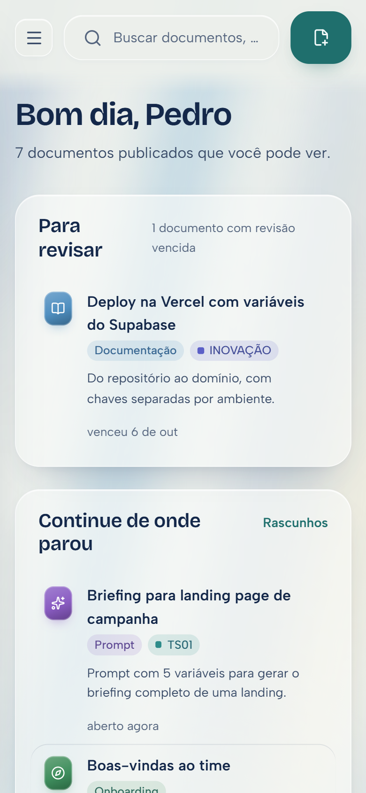

<div align="center">


# DEVDOC

**O que o time sabe, num lugar só.**

Base de conhecimento em markdown para documentação, prompts e códigos,<br />
organizada por operação, departamento e cliente, com permissões decididas no banco.


<br />



</div>

<br />

## Por que existe

Documentação de time costuma morrer de dois jeitos: ninguém acha o que precisa, ou ninguém escreve porque markdown assusta. O DEVDOC ataca os dois lados.

- **Achar em segundos.** Busca com <kbd>Ctrl</kbd> <kbd>K</kbd> que ignora acentos, filtros que viram link compartilhável e painéis por operação.
- **Escrever sem saber markdown.** Editor visual com barra de ferramentas, menu <kbd>/</kbd> e modelos por tipo de documento. O markdown continua sendo a fonte da verdade.
- **Copiar é a ação principal.** Prompts têm variáveis `{{assim}}` para preencher antes de copiar, e todo bloco de código tem o botão copiar.
- **Privado é privado.** Quem pode ler cada documento é decidido no Postgres (RLS), não escondido na interface.

<br />

## Por dentro

<table>
  <tr>
    <td width="50%"></td>
    <td width="50%"></td>
  </tr>
  <tr>
    <td><b>Começar pelo modelo.</b> Cada categoria já traz a estrutura: Resolução de problemas vem com Sintoma, Causa e Correção.</td>
    <td><b>Editor visual.</b> Barra de ferramentas, menu <kbd>/</kbd>, imagens por colar ou arrastar e <kbd>[[</kbd> para ligar outro documento.</td>
  </tr>
  <tr>
    <td width="50%"></td>
    <td width="50%"></td>
  </tr>
  <tr>
    <td><b>Prompts prontos para uso.</b> Preencha as variáveis ao lado e copie o prompt montado.</td>
    <td><b>Cada operação, sua luz.</b> O painel da operação tinge o fundo com a cor dela e mostra fixados, clientes e pessoas.</td>
  </tr>
  <tr>
    <td width="50%"></td>
    <td width="50%" align="center"></td>
  </tr>
  <tr>
    <td><b>Modo claro off-white</b>, pensado para longas horas de leitura.</td>
    <td><b>No celular</b>, para ler, buscar e copiar de qualquer lugar.</td>
  </tr>
</table>

<br />

## Funcionalidades

**Escrever**
- Editor visual (Tiptap) que salva markdown, com alternância para o markdown puro
- Menu <kbd>/</kbd> com títulos, listas, checklist, tabela, código, destaque, imagem e variável de prompt
- Blocos de código com destaque de sintaxe e escolha de linguagem
- Imagens por colar, arrastar ou escolher, com compressão automática e acesso protegido
- Modelos por categoria, editáveis pelo Admin
- Salvamento automático do rascunho; cada publicação gera uma versão no histórico, com restauração
- Links entre documentos com <kbd>[[</kbd> e a lista de quem menciona cada documento

**Organizar e achar**
- Categorias, operações, departamentos, clientes e tags
- Busca em texto completo em português, sem diferenciar acentos
- Filtros por categoria, operação, departamento, cliente, autor, tag e período, guardados na URL
- Painel geral e painel por operação, com favoritos e "continue de onde parou"

**Manter vivo**
- Responsável e prazo de revisão por documento, com o painel "Para revisar"
- Métricas: mais vistos, mais copiados, sem visitas e buscas que não acharam nada
- Lixeira de 30 dias

**Levar e trazer**
- Importar `.md` e `.zip` (com imagens), com prévia antes de entrar
- Exportar `.md`, `.zip` com imagens e PDF
- Metadados no cabeçalho YAML, então o arquivo exportado volta sem perder nada

<br />

## Quem vê o quê

Os níveis formam uma escada: **Operação < Gestor < Admin < Master**. O acesso só é liberado por convite de um Admin ou Master.

| Nível | Pode |
| --- | --- |
| Operação | Criar e editar os próprios documentos |
| Gestor | Editar documentos da própria operação, gerenciar membros dela, fixar documentos e ver métricas |
| Admin | Cadastrar pessoas, operações, departamentos, clientes, categorias e grupos |
| Master | Tudo do Admin, cadastrar Admins e transferir documentos de quem saiu |

Cada documento escolhe quem pode ler: **todos**, **a partir de um nível**, **grupos** (cada operação e cada departamento já é um grupo), **pessoas específicas** ou **só eu**. Um documento "só eu" não é lido nem por Admin nem por Master.

<br />

## Stack

| | |
| --- | --- |
| App | Next.js 15 (App Router, Server Actions), React 19, TypeScript |
| Dados | Supabase: Postgres com RLS, Auth (Google e e-mail), Storage |
| Editor | Tiptap 3 com a extensão oficial de markdown, lowlight |
| Leitura | react-markdown, remark-gfm, rehype-highlight |
| Visual | CSS próprio com tokens, Bricolage Grotesque, Albert Sans, Spline Sans Mono |

O sistema visual se chama **Vitral de Brasília**: vidro fosco sobre faixas de luz azul, verde e areia, inspirado nos vitrais de Marianne Peretti. Cada operação tinge a luz com a sua cor. Detalhes em [DESIGN.md](DESIGN.md).

<br />

## Rodar no computador

Pré-requisitos: Node 20+, pnpm e Docker Desktop aberto.

```bash
pnpm install
npx supabase start     # banco, login e storage locais, já com as migrações
pnpm dev               # http://localhost:3000
```

Crie seu usuário Master local:

```bash
node --env-file=.env.local scripts/create-master.mjs voce@empresa.com.br "Seu Nome" "uma-senha-local"
```

Copie `.env.example` para `.env.local` e preencha com os valores que o `npx supabase start` mostra. E-mails locais (convites e links de acesso) aparecem em http://127.0.0.1:54324.

<br />

## Publicar

**Supabase**
```bash
npx supabase login
npx supabase link --project-ref SEU_PROJECT_REF
npx supabase db push
```
Depois, em **Authentication > URL Configuration**, use o endereço do app como Site URL e adicione `https://SEU-DOMINIO/auth/callback` nas Redirect URLs. Para o login com Google, ative o provedor em **Authentication > Providers**.

**Vercel**

Importe o repositório e configure as variáveis (valores em **Supabase > Project Settings > API**):

| Variável | Observação |
| --- | --- |
| `NEXT_PUBLIC_SUPABASE_URL` | URL do projeto |
| `NEXT_PUBLIC_SUPABASE_ANON_KEY` | Chave pública |
| `SUPABASE_SERVICE_ROLE_KEY` | Só no servidor, nunca exponha |
| `NEXT_PUBLIC_SITE_URL` | Endereço público do app, usado nos convites |

**Primeiro Master na nuvem**
```bash
node --env-file=.env.production.local scripts/create-master.mjs voce@empresa.com.br "Seu Nome"
```
Depois entre com Google, ou use "Primeiro acesso" na tela de login.

<br />

## Formato de importação

Cabeçalho YAML opcional no topo do `.md`:

```yaml
---
titulo: Deploy na Vercel com Supabase
resumo: Do repositório ao domínio
categoria: Documentação
operacao: INOVAÇÃO          # ou "geral"
departamento: Web
clientes: [Cliente A]
tags: [deploy, vercel]
visibilidade: todos         # todos, nivel, grupos, pessoas, privado
nivel_minimo: Gestor        # com visibilidade nivel
grupos: [TS01]              # com visibilidade grupos
pessoas: [ana@empresa.com]  # com visibilidade pessoas
---
```

Um `.zip` pode trazer vários `.md` e as imagens referenciadas por caminho relativo.

<br />

## Estrutura

```
supabase/migrations/     banco, permissões (RLS) e funções
src/app/(app)/           telas logadas: painel, operações, documentos, leitor, editor, métricas, admin
src/components/editor/   editor visual, menu /, links [[, blocos de código, imagens
src/components/reader/   leitura, código com copiar, prompts com variáveis, revisão
src/app/api/             imagens protegidas e exportação
```

<br />

<div align="center">
<sub>Os nomes, documentos e números nas capturas são dados de demonstração.</sub>
</div>
